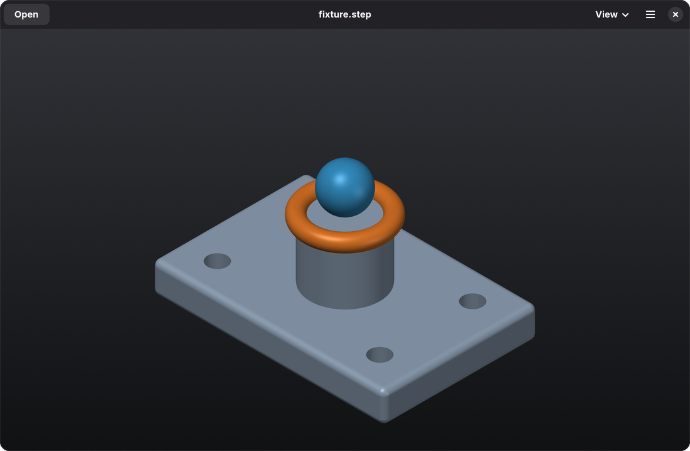
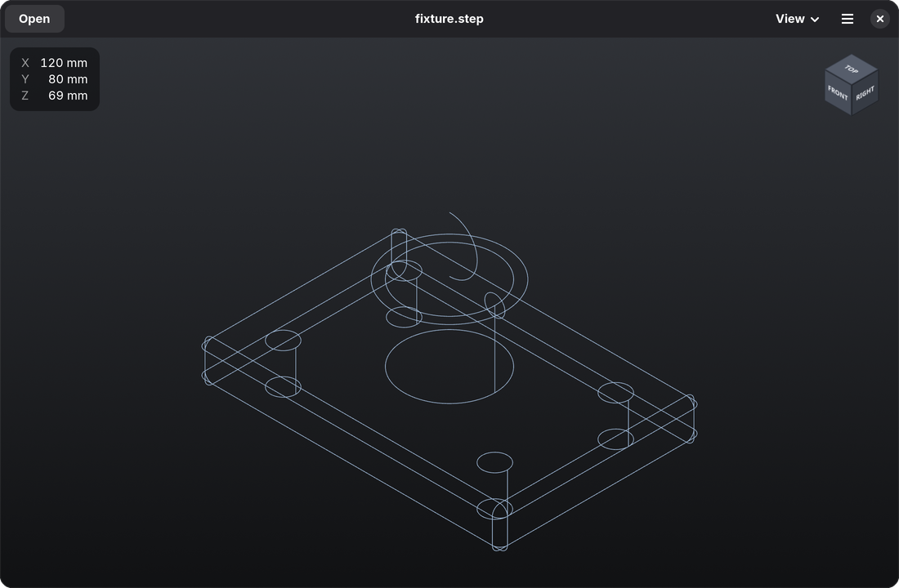
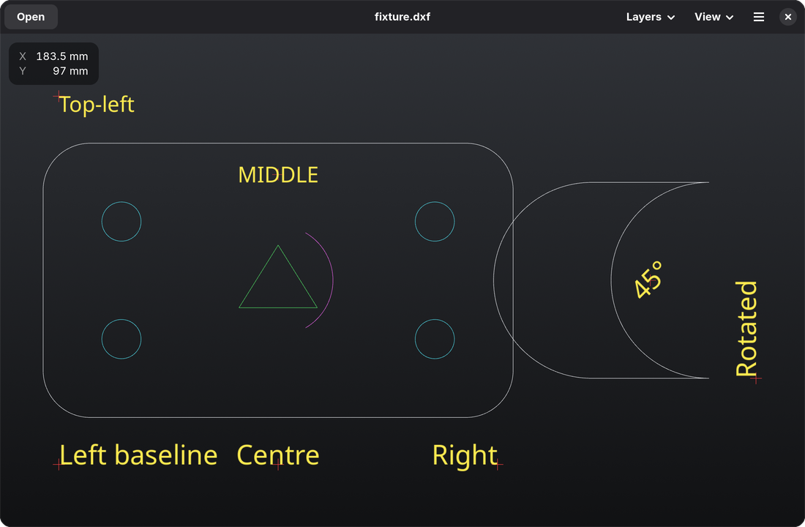

# your-sloppy-viewer

A STEP and DXF viewer for Linux. GTK 4 / libadwaita, native Wayland.

## Features

- Opens `.step` / `.stp` models, with colours; open by file picker, drag-and-drop or command line
- Opens simple 2D `.dxf` drawings in a flat top view, with per-layer visibility (a subset of DXF only, see below)
- Render styles: shaded with edges, shaded, wireframe
- Orthographic and perspective projection
- Orbit (left drag), pan (middle or right drag), zoom toward the cursor (wheel or pinch)
- Standard views, fit to window, clickable orientation cube
- Overall dimensions readout
- Loads in the background with a progress bar; idle when nothing changes

Keyboard shortcuts are listed in the app under Main Menu → Keyboard Shortcuts.

## DXF support

Only a subset of DXF is supported; it will not open every DXF file.

- Supported: ASCII DXF with lines, circles, arcs, polylines (including arc segments), single-line
  text and layer colours, drawn in 2D.
- Not supported: 3D content (solids, meshes), blocks and inserts, splines, ellipses, hatches,
  dimensions, multi-line text, line types, binary DXF and DWG.

Unsupported entities are skipped, so a drawing that relies on them will appear incomplete or empty.

## Build and install

Dependencies (Fedora):

    sudo dnf install gcc-c++ make cmake ninja-build opencascade-devel gtk4-devel libadwaita-devel libepoxy-devel

Build and run without installing:

    make build
    ./build/your-sloppy-viewer model.step

Install for the current user (into `~/.local`) and make it the default app for STEP and DXF files:

    make install

`make uninstall` removes it. `make test` runs the camera checks.

## License

MIT
